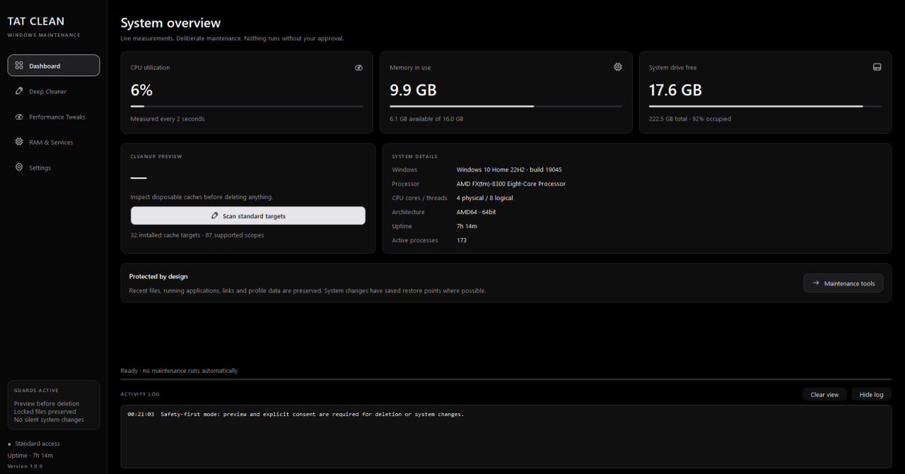

<div align="center">

# TAT Clean
### A cleaner Windows desktop. Gaming controls you can undo.

```text
+---------------------------------------------------------+
|  T A T   C L E A N                                       |
|  INSPECT FIRST.  APPLY DELIBERATELY.  REVERT WHEN NEEDED.  |
+---------------------------------------------------------+
```


[Features](#features) · [Install](#install) · [Build](#build-an-executable) · [Safety](#safety-before-speed) · [Publish to GitHub](docs/GITHUB_PUBLISHING.md)

</div>

**TAT Clean** is a Windows optimization and system-cleaning suite built with Python and PyQt6. Inspect disposable caches across selected drives, experiment with focused gaming/latency settings, and keep durable originals for reversible changes—all in a pitch-black, monochromatic glass-styled interface.

It is an **independent, source-available Hone Ctrl–style alternative**, not an affiliated product or a claim of proprietary feature parity. There are no invented FPS scores or promised ping/input-lag improvements.

> **Why use it?** Precise cleanup scopes. Transparent changes. Explicit approval. A rollback plan.

## Interface

Pure-black surfaces, translucent charcoal cards, silver accents, 12px card corners, scalable vector icons, hover animations and responsive background tasks.

<p align="center">
  
</p>

| View | Description |
| --- | --- |
| **Dashboard** | Live CPU/RAM/storage metrics, system specs, and quick scan access |
| **Gaming & Latency** | Granular tweaks, system timer resolution, and rollback controls |
| **Deep Cleaner** | Multi-drive junk scanning, shader caches, and duplicate detection |
| **RAM & Services** | Working-set optimization and safe, reversible Windows service tweaks |

**Screenshots:** follow the [capture, privacy and placement guide](docs/SCREENSHOTS.md). Raw captures are intentionally excluded from Git. Add only reviewed images under `docs/media/`.

<!-- After reviewing and adding the real screenshots, uncomment this gallery:
<p align="center">
  
</p>
<details>
  <summary>See gaming, cleanup and process controls</summary>
  
  
  
</details>
-->

## Features

### Gaming and latency experiments

| Control | Implementation | Important limitation |
| --- | --- | --- |
| Timer resolution | Managed **0.5 ms / 1.0 ms** `NtSetTimerResolution` requests; released on exit | A timer request is not a measured input-lag reduction or a guarantee about another process's timing |
| TCP / Nagle | `TcpAckFrequency=1`, `TCPNoDelay=1` on selected, verified IPv4 interfaces | TCP-only; many games use UDP and will not benefit |
| MMCSS Games policy | Recognized minimum reserve and Games scheduling/priority fields | Applies to participating MMCSS threads, not every game or GPU workload |
| HAGS | Capability-gated hardware GPU scheduling enable/disable | Supported OS/GPU/driver required; restart needed; results vary |
| Game Mode | Reversible per-user Windows Game Mode flags | Windows and organization policy still govern behavior |
| Ultimate Performance | Create/activate an application-owned power-plan clone; restore the prior plan | Heat/power use can increase; some Modern Standby PCs restrict plans |
| Visual effects | Native animation/drop-shadow settings and named transparency preferences | Appearance/accessibility change, not a game's graphics-quality setting |
| Game priority | HIGH priority for recognized user-owned game processes | REALTIME is prohibited; background responsiveness can worsen |

**Optimize Now applies only selected controls.** Individual apply/revert actions remain available. See [exact registry/API scopes](docs/GAMING.md).

### Multi-drive deep cleaning

- Choose **one drive, several drives, or all eligible local drives**. Network, optical and folder-mount reparse roots are listed but not traversed.
- Keep Windows/profile-specific paths at their actual locations; scan secondary drives only in recognized disposable Temp/cache paths.
- Cover user/system Temp, opt-in Prefetch/Windows Update payloads, DirectX/NVIDIA/AMD shaders and Steam library shader caches.
- Inspect Chrome, Edge, Brave, WebView2, Discord, narrow Telegram/WebKit caches, Roblox, Unreal and Unity scopes.
- Clean old Temp-path installers only when selected; their age/path makes them candidates, **not proof that installed software is orphaned**.
- Find SHA-256 duplicate crash dumps while **retaining one verified copy**. The keeper stays locked during duplicate deletion; missing/changed keepers preserve remaining copies.
- Preserve profile data, installed games, saves, roots/ACLs, links, hard links, recent files, active applications and inaccessible files.

### RAM, services and diagnostics

- Live RAM/CPU/storage/uptime measurements on a separate worker thread.
- One-time **selected working-set trimming**, with clear paging/stutter warnings.
- **Windows memory compression:** left under Windows' control. This version does **not** expose an enable/disable compression switch or claim that trimming is compression.
- Reversible Windows Search, diagnostic telemetry-routing and background game-capture controls; no antivirus/firewall/core-service disabling.
- Validated local preferences, rotating logs, durable baseline journals and privacy-conscious diagnostic export.

## Install

**Requirements:** 64-bit Windows 10 (1809+) or Windows 11; Python 3.11+ for source use. HAGS additionally needs Windows 10 2004+ and compatible hardware/drivers. Launch itself does not require administrator rights.

### Run a reviewed binary release

When a release has been published, download its Windows ZIP from this repository's **Releases** page. Extract the **entire** `TATClean` folder and run `TATClean.exe`; do not copy the executable away from `_internal`.

Verify the published SHA-256 checksum and signature status before elevation. Generated local builds are unsigned unless the maintainer signs them. No release URL is fabricated here.

### Run from source

After cloning/downloading this repository, open PowerShell in its root:

```powershell
python -m venv .venv
.\.venv\Scripts\python.exe -m pip install -r requirements-lock.txt
.\.venv\Scripts\python.exe run.py
```

Alternatively install the package:

```powershell
.\.venv\Scripts\python.exe -m pip install .
.\.venv\Scripts\tatclean.exe
```

## Build an executable

### PyInstaller — validated release path

```powershell
.\.venv\Scripts\python.exe -m pip install -r requirements-dev.lock.txt
.\.venv\Scripts\python.exe -m pip install -e . --no-deps
.\build.ps1
```

The script runs static checks/tests, builds from `TATClean.spec`, performs an isolated **read-only** packaged smoke test, and produces versioned Windows/source ZIPs plus `dist/SHA256SUMS.txt`. Current source validation includes 189 tests; check the actual CI run rather than treating this number as a performance guarantee.

```text
dist/TATClean/TATClean.exe
dist/TATClean/_internal/...
dist/TATClean-1.1.0-windows-x64.zip
dist/TATClean-1.1.0-source.zip
dist/SHA256SUMS.txt
```

### Nuitka — alternative build recipe

Install a supported C compiler/Windows SDK, then use the [Nuitka steps in the deployment guide](docs/DEPLOYMENT.md#alternative-nuitka-build). Start with standalone mode so missing plugins/data files are visible. This route is **not yet a validated release build**; do not label its output tested until its own checks pass.

## Safety before speed

> **Cache deletion is permanent. A System Restore point does not recover deleted cache files, dumps, installers or Recycle Bin contents.**

1. **Preview before deletion.** Scans are asynchronous; interrupted/expired previews cannot be cleaned. Removal uses revalidated exclusive Win32 handles.
2. **Protect before changing.** Registry/service/gaming mutations require a verified Windows System Restore point and durable originals. System Protection must already be enabled; Windows' point-creation quota is not bypassed.
3. **Revert deliberately.** Failed gaming batches attempt reverse-order rollback. Conflicting external changes are not overwritten; failed journals are retained for review.
4. **Benchmark, don't assume.** Cache rebuilds, shader compilation, paging, HAGS, power or TCP settings can make a workload slower. No universal FPS, latency or bandwidth gain is promised.
5. **Elevate explicitly.** Use the same Windows account. On managed PCs, consult the administrator; organization/security policies are not bypassed.
6. **Restore before uninstalling.** Persistent tweaks do not disappear when binaries are removed. Use Settings → **Restore saved changes** first.

Local settings, logs, manifests and baselines live in `%LOCALAPPDATA%\TATClean`. Never publish that directory. Keep `state.sqlite` and any SQLite sidecars together until saved changes are restored.

## Contributing and publishing

```powershell
.\.venv\Scripts\python.exe -m pytest
.\.venv\Scripts\python.exe -m ruff check .
```

Tests use temporary fixtures and mock invasive system operations. Do not replace them with real networking/service/registry changes on a developer PC.

- [Safe GitHub publishing commands](docs/GITHUB_PUBLISHING.md)
- [Screenshot capture and privacy guide](docs/SCREENSHOTS.md)
- [Promo-video tools and storyboard](docs/PROMO_VIDEO.md)
- [Architecture](docs/ARCHITECTURE.md) · [Safety](docs/SAFETY.md) · [Deployment](docs/DEPLOYMENT.md)

For bug reports, include Windows/Python/app versions, the affected control and reproduction steps. Review/redact diagnostic exports before attaching them. Do not submit credentials, private process/network details or raw baseline databases in public issues.

## Licensing and trust

This project's own source is MIT-licensed. **PyQt6's GPLv3/commercial terms and Qt/dependency obligations still apply to distributed binaries.** Review [third-party notices](THIRD_PARTY_NOTICES.md), corresponding-source obligations and code signing before public/proprietary distribution. The source ZIP does not claim to fulfill every dependency's source-offer requirement.

TAT Clean is independent software: no affiliation with Hone, Microsoft, NVIDIA, AMD or the listed application vendors is implied. Use it for transparent, measured maintenance—not claims of a magic boost.
